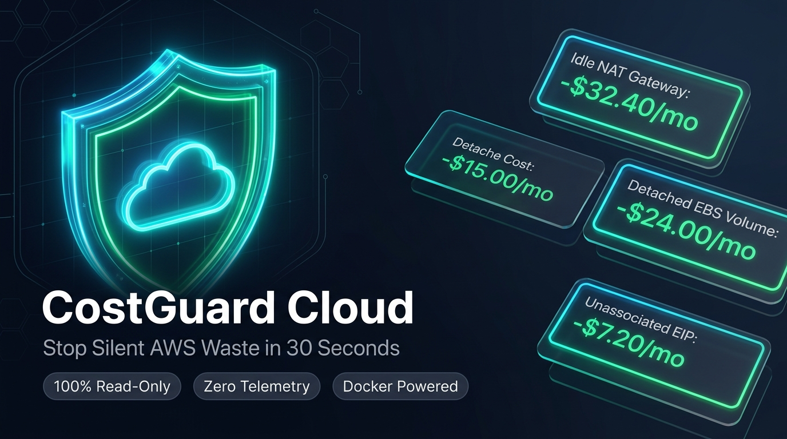

<p align="center">
  
</p>

# CostGuard Cloud (AWS) 🛡️💰

[](https://github.com/asifMuzammil/costguard-cloud/pkgs/container/costguard)
[](#-security--privacy-guarantee)
[](#-security--privacy-guarantee)
[](LICENSE)

> **Stop Silent AWS Waste in 30 Seconds.**  
> CostGuard Cloud is a zero-knowledge, 100% read-only CLI & Docker tool that audits your AWS accounts for abandoned, idle, and zombie resources bleeding your monthly cloud budget.

Developed by **[Asif Muzammil](https://github.com/asifMuzammil)** — AWS Community Builder (Containers).

---

## ⚡ 30-Second Quickstart (Zero Installation)

You don't need Python or dependencies installed. If you have Docker and AWS credentials configured, run:

```bash
docker run --rm -it \
  -v ~/.aws:/root/.aws:ro \
  -v $(pwd)/costguard-report:/app/output \
  ghcr.io/asifmuzammil/costguard:latest scan
```

> **Why `:ro`?** The `:ro` flag mounts your `~/.aws` folder in **strictly READ-ONLY mode**. The Docker container cannot write, alter, or upload your credentials at the OS level.

---

## 🔒 Choose Your Connection Mode

We believe security is non-negotiable. Choose the authentication style that best fits your company's policy:

### Mode A: Fast Audit with Existing Profile (Zero-Setup)
If you already use `aws configure` or named profiles (e.g., `default`, `staging`, `production`), run directly:

```bash
# Scan default profile across top regions
docker run --rm -it \
  -v ~/.aws:/root/.aws:ro \
  -v $(pwd)/costguard-report:/app/output \
  ghcr.io/asifmuzammil/costguard:latest scan

# Or scan a specific profile across all regions
docker run --rm -it \
  -v ~/.aws:/root/.aws:ro \
  -v $(pwd)/costguard-report:/app/output \
  ghcr.io/asifmuzammil/costguard:latest scan --profile production --all-regions
```

---

### Mode B: "Paranoid Mode" (Disposable Read-Only User)
If you don't want to use admin credentials, create a disposable, 100% read-only IAM user in **30 seconds**. Run the audit, and delete the user immediately:

#### 1. Create Disposable Audit User (CLI)
```bash
# Create temporary audit user
aws iam create-user --user-name costguard-audit

# Attach AWS official Read-Only SecurityAudit policy
aws iam attach-user-policy \
  --user-name costguard-audit \
  --policy-arn arn:aws:iam::aws:policy/SecurityAudit

# Generate temporary access keys
aws iam create-access-key --user-name costguard-audit
```

#### 2. Run the Audit
```bash
aws configure --profile costguard-audit
docker run --rm -it \
  -v ~/.aws:/root/.aws:ro \
  -v $(pwd)/costguard-report:/app/output \
  ghcr.io/asifmuzammil/costguard:latest scan --profile costguard-audit
```

#### 3. Delete the User Afterward (Zero Footprint)
```bash
aws iam detach-user-policy --user-name costguard-audit --policy-arn arn:aws:iam::aws:policy/SecurityAudit
aws iam delete-user --user-name costguard-audit
```

*(You can also follow the exact same steps in the AWS Web Console under **IAM > Users**).*

---

## 📊 What CostGuard Detects

| Zombie Resource | Why It Wastes Money | Monthly Cost Impact |
| :--- | :--- | :--- |
| **Idle NAT Gateways** | Empty VPC NAT Gateways with near-zero traffic over 7 days | **$32.40 / mo** each + data fees |
| **Detached EBS Volumes** | Storage disks left unattached (`available`) after EC2 instances termination | **$0.08 - $0.125 / GB / mo** |
| **Unassociated Elastic IPs** | Allocated public IPs not attached to any running ENI or instance | **$3.60 / mo** each |
| **Untagged / Dangling ECR Images** | Orphaned container image layers taking up billable registry storage | **$0.10 / GB / mo** |

---

## 🖥️ Terminal Output Preview

```text
🚀 Initializing CostGuard Cloud (AWS) Scan for Account: 235248622072...
  🔍 Scanning region: us-east-1...
  🔍 Scanning region: us-east-2...

======================================================================
  CostGuard Cloud (AWS) - Waste Audit Report
  Target Account: 235248622072
  Regions Scanned: us-east-1, us-east-2
======================================================================

💰 ESTIMATED MONTHLY WASTE : $64.80 USD
📉 PROJECTED ANNUAL LEAK    : $777.60 USD
🔍 TOTAL ZOMBIE ITEMS FOUND : 2

----------------------------------------------------------------------
[1] [CRITICAL] Idle NAT Gateway
    ID     : nat-01a2b3c4d5e6f7 (VPC-Staging)
    Region : us-east-1
    Details: Only 0.12 MB transferred in 7 days
    Waste  : $32.40 / month
    Fix    : aws ec2 delete-nat-gateway --nat-gateway-id nat-01a2b3c4d5e6f7 --region us-east-1

[2] [HIGH] Unattached EBS Volume
    ID     : vol-0987654321fedcba (test-db-disk)
    Region : us-east-2
    Details: 100 GB (gp3), Created: 2026-09-12
    Waste  : $8.00 / month
    Fix    : aws ec2 delete-volume --volume-id vol-0987654321fedcba --region us-east-2

======================================================================
📁 Detailed Interactive HTML Report generated at:
   ./costguard-report/index.html
```

---

## 📈 Interactive HTML Report

Every scan automatically produces a standalone, dark-mode **`index.html`** dashboard inside `./costguard-report/`:
* **Zero Dependencies:** Open directly in any web browser (`double-click` or `open ./costguard-report/index.html`).
* **C-Suite & Manager Ready:** Includes executive summary cards, breakdown by service, and total projected annual savings.
* **1-Click Copy Fix:** Direct AWS CLI remediation commands next to every item with one-click copy buttons.
* **Print / Export PDF:** Ready to print or attach to DevOps sprint reviews.

---

## 🛡️ Security & Privacy Guarantee

* **100% Read-Only:** Built upon AWS `Describe*` and `Get*` APIs. It cannot modify, reboot, or delete any resource.
* **No Telemetry / No Tracking:** Zero analytics tokens, zero external API calls. The container communicates **only** with official AWS endpoints (`*.amazonaws.com`).
* **Zero Data Retention:** Nothing is stored on any cloud server. The generated HTML report lives solely on your local filesystem.
* **Manual Remediation Only:** CostGuard suggests copyable fix commands for human review; it **never** auto-deletes resources.

---

## 💻 Standalone Python Run (Without Docker)

If you prefer running via Python directly:

```bash
# 1. Clone repository
git clone https://github.com/asifMuzammil/costguard-cloud.git
cd costguard-cloud

# 2. Install minimal requirements (boto3)
pip install -r requirements.txt

# 3. Run audit
python3 -m costguard.cli --all-regions
```

---

## 🤝 Community & Support

* **Author:** [Asif Muzammil](https://github.com/asifMuzammil) (AWS Community Builder - Containers)
* **Issues & Feedback:** Found a bug or want a new scanner (e.g. RDS idle instances, ALBs)? Open an [Issue](https://github.com/asifMuzammil/costguard-cloud/issues).
* **Star the Repo:** If CostGuard saved your team money, please give the repo a ⭐ to help other AWS engineers discover it!
